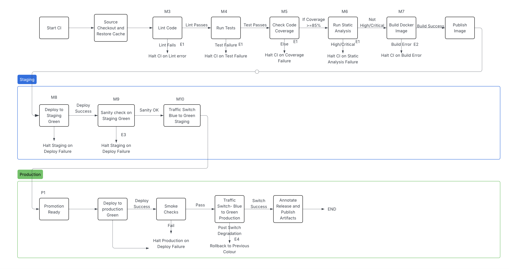

# COFFEE PROJECT 

CSC 519 \- DevOps: Modern Software Engineering Practices  
Project Proposal

**Zero-Downtime Coffee Deployment Pipeline**  
By:  
[Sanjaey Shunmuga Sundaram](mailto:sshunmu@ncsu.edu) \- sshunmu  
[Srinivasa Karthikeya Reddy Kovvuri](mailto:skovvur@ncsu.edu) \- skovvur  
[Ravi Chandu Bollepalli](mailto:rbollep@ncsu.edu) \- rbollep

**Problem Statement:**

Many small scale companies and startups have small development teams that often deploy web applications manually, uploading files to servers, restarting processes and hoping nothing breaks. This practice is prone to errors, inconsistent and risky because one small mistake can take the entire service down. For example developers at times may have to SSH into servers, restart services manually or fix broken deployments after merging updates. This becomes problematic especially when a service needs to be highly available where even minimal downtime can lead to failed orders, or inconsistencies such as coffee ordering applications. 

This is important because manual deployments are slow, risky and make debugging harder when issues arise after a release. It matters because in modern DevOps practices automation, consistency and resilience are key factors. 

Our aim is to design a Zero-Downtime Continuous Deployment Pipeline which fully automates code testing, linting, and deployment into containerized environments, while ensuring safe code merges through protected release branches. 

Our automated pipeline will 

* Continuously test every change for quality and security.  
* Deploy the updates safely using Blue-Green deployment which allows us to deploy with zero-downtime.   
* Monitor the system’s health in real time to catch issues. 

We automate the CI/CD with Github Actions, performing linting and testing checks, provisioning environments using Ansible, enforcing branch protection rules, deploying via a release branch trigger and finally deploying updates to a containerized environment using a blue-green deployment to ensure the zero downtime.

**Use Case:**  

**1. Preconditions**

release/* is a protected branch with required reviews.  
Staging has two targets: blue (current) and green (idle), reachable over SSH.  
GitHub Actions is set up with access to GHCR and the staging hosts.  
Ansible inventory and Nginx templates for blue/green are available.  
Tooling exists in CI: Node.js, ESLint, Mocha/Jest+Supertest, NYC, SonarQube/CodeQL, Docker.  

---

**2. Main Flow**

- **[M1]** Developer merges `dev` into `release/x.y`.  
- **[M2]** CI runs the standard checks with staging thresholds:  
  - **[M3]** Lint  
  - **[M4]** Unit + Integration Tests  
  - **[M5]** Coverage (≥85%)  
  - **[M6]** Static Analysis  
- **[M7]** Build Docker image `coffee:stage_d-<sha>`, tag with commit SHA, push to GHCR.  
- **[M8]** CD starts — Ansible deploys the new image to **green** in staging.  
- **[M9]** Sanity checks run on **green** (`/health`, `/coffees`, `/order`, `/orders`).  
- **[M10]** If green is healthy, Nginx switches traffic from **blue** to **green** (no downtime).  
- **[M11]** Pipeline records the result and artifacts (reports, image digest, staging URL).  

---

**3. Subflows**

- **[S1]** CI uploads test/coverage/analysis reports to the job summary.  
- **[S2]** Deployment uses `group_vars/staging.yml` for environment settings.  
- **[S3]** After the switch, the previous color is retired and ready to be reused next cycle.  

---

**4. Alternative Flows**

- **[E1]** Lint/tests/coverage/static analysis fail → CI stops; no image is published. *(from [M3–M6])*  
- **[E2]** Image build or push fails → CI fails; deployment is not attempted. *(from [M7])*  
- **[E3]** Sanity checks on green fail → no switch; blue continues serving; job marked failed. *(from [M9])*  
- **[E4]** Post-switch degradation detected → switch back to the previous color immediately; job marked failed. *(from [M10])*  

---

**5. Postconditions**

- **[P1]** Staging serves the new version with zero downtime if all checks pass. *(after [M10])*  
- **[P2]** A validated build is available for promotion from `release/x.y` to `main`.  

---

**Pipeline Design:**  

